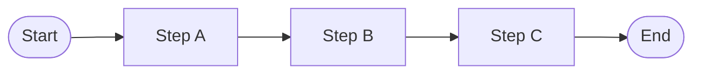
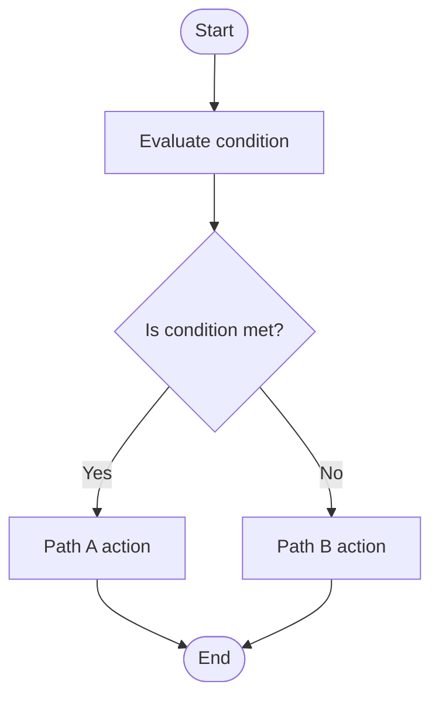
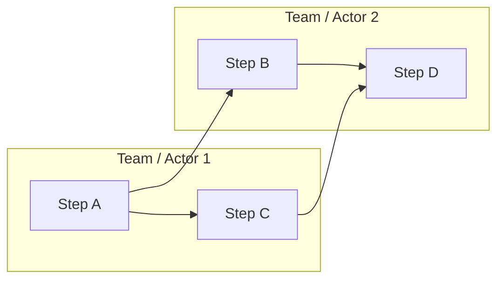
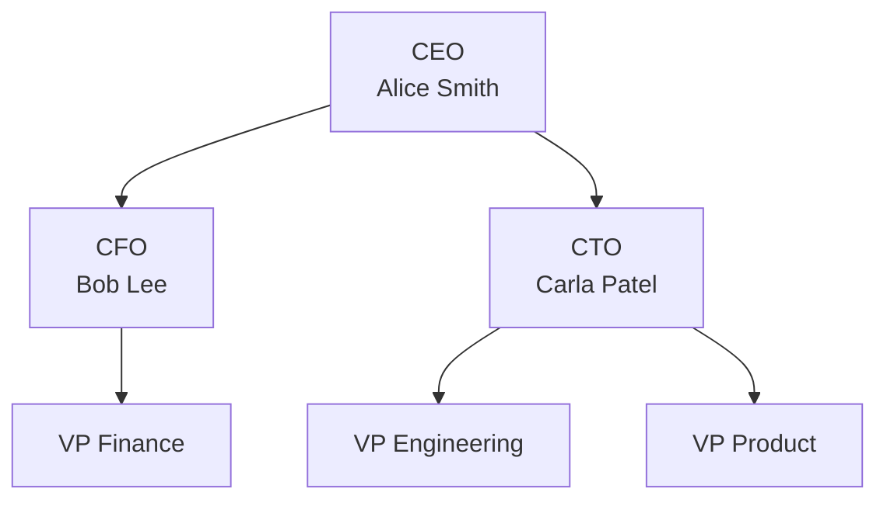
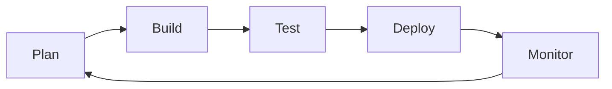
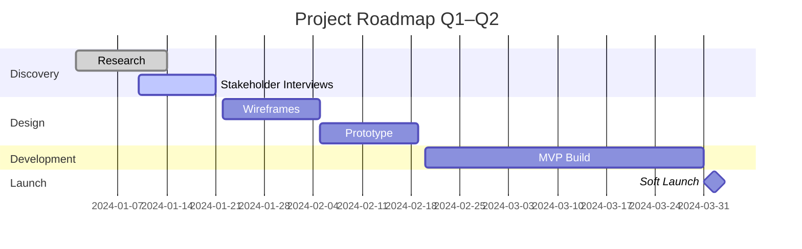
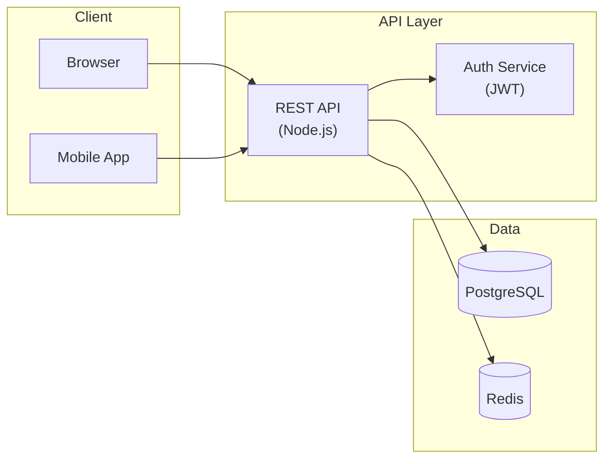

# Diagram Guide

## Construction Rules (Universal)

These rules apply to every diagram regardless of type:

1. **One color system** — all diagrams use the same palette as the deck (defined in `color-systems.md`)
2. **One icon family** — if icons appear in diagrams, same family and variant as the rest of the deck
3. **Consistent shapes** — node shapes convey meaning; never change shape type mid-diagram for aesthetic variety
4. **Label everything** — every node and every connector must have a label. Unlabeled connectors are ambiguous.
5. **7±2 nodes** — more than 9 nodes is cognitively overloaded; split into sub-diagrams with a parent overview
6. **Minimum text in nodes** — 1–4 words per node label (detail goes in the speaker notes or a legend)
7. **Alignment** — all nodes snap to a grid; no floating/organic positioning
8. **One direction of flow** — flows read left-to-right or top-to-bottom; never diagonal or circular unless the diagram type requires it (e.g., cycle)

---

## Standard Node Shapes (BPMN-inspired)

| Shape | Meaning | Use for |
|---|---|---|
| Rounded rectangle | Process / step | Any action or activity |
| Diamond | Decision / gateway | Any Yes/No or branch point |
| Parallelogram | Input / output | Data entering or leaving the process |
| Oval / Pill | Start / End (terminal) | First and last node only |
| Rectangle (sharp corners) | Document / artifact | A document or deliverable produced |
| Circle | Event / trigger | Something that happens (time, condition, message) |
| Hexagon | Preparation | Setup or configuration steps |
| Cylinder | Data store | Database, file system |

---

## 1. Horizontal Process Flowchart

**When to use:** Sequential steps with a clear start and end. No decisions required.

**Structure:**
```
[Start] → [Step A] → [Step B] → [Step C] → [End]
```

**Mermaid syntax:**


**Rules:**
- Maximum 7 steps before using a "continued on next diagram" node
- Steps flow left-to-right; start and end use oval/pill shapes
- Optional: Add numbered labels (1, 2, 3…) above nodes for spoken reference

---

## 2. Decision Flowchart (Branch)

**When to use:** A process that splits based on a condition, with different paths for different outcomes.

**Structure:**
```
[Start] → [Step] → {Decision} → Yes → [Path A] → [End]
                              → No  → [Path B] → [End]
```

**Mermaid syntax:**


**Rules:**
- Diamond nodes ALWAYS have labeled branches (Yes/No, Approve/Reject, Pass/Fail)
- Never leave a branch unlabeled
- Re-join paths at a merge node before terminal if the process continues

---

## 3. Swimlane Diagram (Cross-functional)

**When to use:** Same process, but multiple teams/actors are responsible for different steps.

**Structure:**
```
| Actor 1 | [Step A] ─────────────────── [Step C] |
|---------|                                       |
| Actor 2 |         [Step B]─────── [Step D]      |
```

**Mermaid syntax:**


**Rules:**
- One lane per actor/team; actors on the Y-axis, time on the X-axis
- Handoff connectors (crossing lanes) must be clearly visible — use a different color or dashed line
- Never put more than 3 actors in a swimlane diagram per slide; use appendix for full cross-functional maps

---

## 4. Org Chart

**When to use:** Reporting hierarchy, team structure, authority levels.

**Structure:** Tree, root at top, branches downward.

**Mermaid syntax:**


**Rules:**
- Maximum 4 levels visible on one slide; deeper levels collapse to a "See A-3" reference
- Each node: Name + Title (no extra details in the diagram)
- Show only the relevant part of the org for the audience — never the entire company unless that IS the point

---

## 5. Cycle / Circular Process Diagram

**When to use:** Recurring or cyclical processes (e.g., agile sprint, customer lifecycle, feedback loop).

**Structure:** Circular arrow sequence — arrows form a closed loop.

**Mermaid syntax:**


**Rules:**
- The last step must have an arrow pointing back to the first — if not, it's not a cycle
- Label the cycle name in the center (achieved via a central node with `:::hidden` style or an image overlay)
- 4–6 phases is the ideal range for a cycle diagram

---

## 6. Venn Diagram

**When to use:** Overlapping sets, shared properties, intersection of two or three categories.

**Construction (no native Mermaid support — use shapes in presentation tool):**
- Two overlapping circles: left label, right label, intersection label
- Three overlapping circles: same, with three binary intersections and one central intersection
- Use accent color for the intersection (the key insight is usually in the overlap)

**Rules:**
- Maximum 3 circles — beyond this, a Venn diagram becomes unreadable
- Label every region, including the non-overlapping parts
- The intersection must be labeled with its specific meaning

---

## 7. 2×2 Matrix (BCG / Consulting)

**When to use:** Positioning items on two axes to reveal strategic implications.

**Structure:**
```
         High │ [Quadrant TL] │ [Quadrant TR]
    Y-Axis    │───────────────┼───────────────
         Low  │ [Quadrant BL] │ [Quadrant BR]
              └───────────────────────────────
                   Low              High
                        X-Axis
```

**Common frameworks:**
| Framework | X-Axis | Y-Axis | Quadrant names |
|---|---|---|---|
| BCG Growth-Share | Relative Market Share | Market Growth | Cash Cow, Star, Question Mark, Dog |
| Effort-Impact | Implementation Effort | Business Impact | Quick Wins, Major Projects, Fill-ins, Thankless |
| Risk-Reward | Risk | Potential Reward | Bold bets, Safe bets, Avoid, Low priority |
| Urgency-Importance (Eisenhower) | Urgency | Importance | Do Now, Schedule, Delegate, Delete |

**Rules:**
- Label all four quadrants
- Name both axes with clear direction indicators (Low → High)
- Plot items as labeled dots or named icons; max 8–10 items before the diagram becomes cluttered
- Highlight the recommended quadrant with accent fill

---

## 8. Gantt / Timeline

**When to use:** Project schedule, roadmap, milestone tracking.

**Mermaid Gantt syntax:**


**Rules:**
- Use `done`, `active`, `crit` status markers to distinguish past/current/overdue tasks
- Milestones use `milestone` type — show as a diamond
- Critical path items use `crit` — highlight in accent color
- For a high-level roadmap (not granular schedule), use a horizontal timeline with phase labels instead of a full Gantt

---

## 9. Customer Journey Map

**When to use:** Showing the end-to-end customer experience across phases.

**Structure (table-based, not flowchart):**
```
Phase:        | Awareness | Consideration | Decision | Onboarding | Retention
Actions:      | Sees ad   | Reads review  | Trial    | Setup      | Uses daily
Thoughts:     | "Is this  | "How does     | "Is it   | "Hope this | "Love this"
              |  for me?" |  it work?"    | worth it?|  works"    |
Emotions:     | Curious   | Skeptical     | Anxious  | Hopeful    | Satisfied
Touchpoints:  | Social    | Website       | Sales    | Email      | App
Pain Points:  |           | UX unclear    | Pricing  | Complex    |
Opportunities:|           | Better demo   | Trial CTA| Onboarding |
```

**Rules:**
- Minimum 4 rows (Actions, Thoughts, Emotions, Touchpoints); Pain Points and Opportunities are highly recommended
- Emotional journey is often shown as a line graph overlaid on the grid (peaks = positive, valleys = friction)
- Highlight pain points in a warning color (amber or red); opportunities in the accent/positive color
- This is always a wide-format slide (consider landscape orientation or a dedicated appendix page)

---

## 10. Architecture Diagram

**When to use:** Technical system components and their connections. Software architecture, infrastructure, data pipelines.

**Structure:**
- Use boxes for services/components, grouped by bounded context (dashed border or background fill)
- Use arrows for data flow (labeled with protocol or data type)
- Use cylinder for data stores, cloud shape icons for managed services

**Mermaid syntax:**


**Rules:**
- Group components by layer (client, API, data, infra) using subgraphs
- Label every arrow with the protocol, data type, or trigger condition
- External systems get a distinct visual treatment (dashed border, grey fill)
- For a non-technical audience: simplify to 3–4 boxes; put the full diagram in appendix

---

## 11. Funnel Diagram

**When to use:** Showing conversion stages, pipeline stages, or progressive filtering.

**Construction (no native Mermaid — use shapes in presentation tool):**
- Stacked trapezoid shapes, wide at top, narrow at bottom
- Each stage: label (left or inside), value (right or inside)
- Color: gradient from accent color (full value at top) to a lighter shade at bottom, OR color-code by health (green/amber/red)

**Rules:**
- Label both the stage name AND the quantity/percentage at each stage
- Show drop-off rate between stages (e.g., "40% conversion")
- Maximum 6 stages — beyond that, group into macro stages

---

## 12. Pyramid / Triangle Diagram

**When to use:** Hierarchical importance, prioritization, Maslow-style layering.

**Structure:**
- Base (widest, bottom) = most foundational, ubiquitous, or important
- Apex (narrowest, top) = most specialized, rare, or aspirational

**Layers:**
- 3–5 horizontal bands
- Each band: colored fill + label (inside or alongside)

**Rules:**
- Establish whether "top is best" or "bottom is most fundamental" — label accordingly
- Use color intensity to signal progression (light at base → dark at apex OR reverse)

---

## 13. Sankey Diagram

**When to use:** Flow volume between categories, budget allocation, energy/material flows.

**Rules:**
- Width of bands is proportional to quantity — this is the primary encoding; do not violate it
- Color-code by source category
- Label source nodes (left), destination nodes (right), and optionally the flow quantity on each band
- For presentations, consider using a static screenshot of a tool-generated Sankey (D3.js, SankeyMATIC, Flourish) rather than building from scratch

---

## Diagram Quality Checklist

Before including any diagram on a slide:

```
☐ Every node has a label (1–4 words)
☐ Every connector has a label (especially decision branches)
☐ Number of nodes ≤ 9 (7±2 rule)
☐ Shapes are used consistently (rounded rect = process, diamond = decision, etc.)
☐ Color system matches the deck
☐ Icon family and variant matches the deck
☐ Diagram has a clear entry point and exit point (or is a closed loop)
☐ Diagram headline states the insight the diagram proves
☐ For technical diagrams shown to non-technical audiences: simplified version in main deck, full diagram in appendix
```
